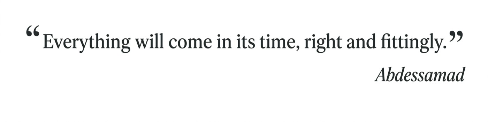

  <picture>
    <source media="(prefers-color-scheme: dark)" srcset="quote-dark.jpg">
    
  </picture>

<h1 align="center">Hello! I'm Abdessamad Ait Brahim</h1>

<h3 align="center">
  Final-Year Engineering Student in Big Data &amp; Artificial Intelligence
</h3>

  

  
  
  

---

## About Me

Final-year Engineering Student in **Big Data & Artificial Intelligence** at **ENSA Tétouan, Morocco**.

Interested in **Machine Learning, Deep Learning, Computer Vision, NLP, and Multimodal AI**, with a focus on building reliable, data-driven AI solutions through rigorous experimentation and evaluation.

Exploring AI research and real-world applications across scientific and industrial domains.

Seeking a **6-month PFE internship starting in early 2027**, with a long-term goal of pursuing a PhD in AI.

---
## Technical Skills

  

  

  
  
  
  
  
  
  
  
  
  
  
  
  
  
  

---

  <picture>
    <source media="(prefers-color-scheme: dark)" srcset="https://raw.githubusercontent.com/abdessamadaitbrahim/abdessamadaitbrahim/output/github-snake-dark.svg">
    
  </picture>

  <samp>✦ Building strong foundations in AI, one experiment at a time.</samp>
   
  <i>Learn · Experiment · Innovate</i>

